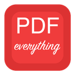

<h1 align="center">
  
  &nbsp;PDFeverything
</h1>

<p align="center">
  <b>🪄 The PDF Swiss Army Knife</b><br>
  <sub>Throw in PDFs, Word docs, PowerPoints, Excel sheets, images, text files —<br>get one clean PDF out the other end. No fuss.<br>Built-in <b>high-performance PDF reader</b> with vector-grade rendering.</sub>
</p>

<p align="center">
  <a href="https://github.com/Lezheng2333/PDFeverything/releases"></a>
  <a href="https://github.com/Lezheng2333/PDFeverything/releases/latest"></a>
  <a href="resources/LICENSE.txt"></a>
</p>

<p align="center">
  <sub><a href="#chinese">🇨🇳 中文版 ↓</a></sub>
</p>

---

## ✨ Why PDFeverything?

You've been there: a Word report here, a PDF scan there, some photos of the whiteboard, an Excel chart… and now someone wants "*one combined PDF please, by 5pm*". 😤

**PDFeverything is built for exactly this moment.**

Drag everything in — any combination of PDFs, Word documents, PowerPoint decks, Excel spreadsheets, PNGs, JPEGs, text files — and it merges them into **one unified PDF**, in the order you decide, with progress you can watch.

| Platform | Download |
|---|---|
| 🍎 macOS (Apple Silicon, 13+) | [`PDFeverything_macOS_v2.0.2.zip`](https://github.com/Lezheng2333/PDFeverything/releases/download/v2.0.2/PDFeverything_macOS_v2.0.2.zip) |
| 🪟 Windows 10/11 (64-bit) | [`PDFeverything_Setup_v2.0.2.exe`](https://github.com/Lezheng2333/PDFeverything/releases/download/v2.0.2/PDFeverything_Setup_v2.0.2.exe) |

> 🔗 [**Latest Release →**](https://github.com/Lezheng2333/PDFeverything/releases/latest)
>
> 🍎 The macOS download is a ZIP containing `PDFeverything.app` — drag it into Applications.
>
> 🪟 The Windows download is an **installer** — bilingual wizard, licence page, Start Menu
> entry, optional desktop shortcut and a standard uninstaller. No Python required.
>
> 🔐 Checksums for both assets: [`SHA256SUMS.txt`](https://github.com/Lezheng2333/PDFeverything/releases/download/v2.0.2/SHA256SUMS.txt)

## 🆕 v2.0.2 — runs on macOS 26 and every Apple-silicon macOS since Ventura

A macOS portability fix for [issue #1](https://github.com/Lezheng2333/PDFeverything/issues/1):
the 2.0.1 bundle was actually built for **macOS 27** (pyenv Python 26.0, Homebrew
OpenSSL 27.0) while its `Info.plist` promised 11.0 — dyld refused to start it on
macOS 26.

- **Portable runtime** — built with the official python.org universal2 Python (macOS 11 baseline) instead of a pyenv build that inherits the build machine's OS; no Homebrew dylibs are bundled any more.
- **pikepdf dropped** — lossless compression uses the MuPDF already inside the app; one native dependency less, and its macOS-14 wheel floor disappears.
- **arm64 by default** — native on every Apple-silicon Mac; `LSMinimumSystemVersion` is now the honest **13.0** (Qt 6.11 baseline).
- **Build-time guard** — `build_macos.py` refuses to package when Python, Qt or a wheel raises the floor, then audits every Mach-O in the finished app. `PDFeverything --doctor` prints the same report from inside the app.
- **Crash logs** — uncaught exceptions and fatal signals land in `~/Library/Logs/PDFeverything/crash.log` instead of vanishing.
- **Tests** — new `tests/test_macos_compat.py` (40 checks); full suite now 562.

Read [docs/MACOS_COMPAT.md](docs/MACOS_COMPAT.md) for the full diagnosis, the compatibility matrix and the reproducible build.

**Release:** [PDFeverything v2.0.2](https://github.com/Lezheng2333/PDFeverything/releases/tag/v2.0.2) (2026-11-09) ·
[compatibility notes](docs/MACOS_COMPAT.md) ·
[checksums](https://github.com/Lezheng2333/PDFeverything/releases/download/v2.0.2/SHA256SUMS.txt)

## v2.0.1 — three color schemes & hardening

A patch release on top of Studio 2.0: three palettes, security fixes, and a broad
correctness/QA pass.

- **Three color schemes** — Forest green, Warm cherry and Florence blue, each with light/dark variants; choose under **Settings → Color scheme**, persisted per user.
- **Security** — AppleScript conversion now passes paths through `argv` (no script injection); Windows COM uses a private Office instance and never quits the user's session.
- **Compression fixed** — medium/max no longer write zlib data behind `/DCTDecode`; RGB and grayscale images decode correctly again.
- **Legacy Office formats** — `.doc` / `.rtf` / `.ppt` / `.xls` now fail with an actionable "install Office or save as .docx/.pptx/.xlsx" message instead of a raw ZIP/parser error.
- **MCP robustness** — stdout stays valid JSON on non-UTF-8 Windows pipes; `pages: "all"` works; page-edit history is persisted so undo/redo survives across calls.
- **Reader/Studio polish** — grid styles refresh on theme change, the welcome artwork follows the scheme, outline/search status survive language switches, print keeps caller page order, and sort/merge respect the current selection.
- **Document safety** — encrypted/corrupt inputs get clear errors; metadata and bookmarks survive encrypt/decrypt/rotate/watermark/move; in-place edits keep file permissions.
- **Tests** — 522 checks across seven suites (97 core + 70 GUI + 38 reader QA + 85 reader + 170 adversarial + 37 defects + 25 Studio).

**Release:** [PDFeverything v2.0.1](https://github.com/Lezheng2333/PDFeverything/releases/tag/v2.0.1) (2026-11-02) ·
[QA record](docs/RELEASE_QA_2.0.1.md) ·
[checksums](https://github.com/Lezheng2333/PDFeverything/releases/download/v2.0.1/SHA256SUMS.txt)

## Studio 2.0 (v2.0.0) — the document workspace

A complete native desktop redesign: warm neutrals, forest green, a live light/dark theme,
vector artwork, and a calmer layout built around the way you work.


- **Workspace** — drop mixed files, inspect format/size/pages, reorder, and combine.
- **Tool library** — 18 searchable tools in four categories, with bilingual search.
- **Quick actions** — press **⌘/Ctrl+K**, type a tool, then Enter to run it.
- **Reader** — a new welcome screen, recent documents, page-number click to jump,
  and the existing fast search, contents, grid editing, and reading-position memory.
- **Queue upgrades** — import folders, naturally sort filenames, and move multiple selected files together.
- **Activity history** — reopen results from the last 30 jobs; clear the history whenever you like.
- **Native printing** — choose a system printer and print selected PDF pages with their proportions preserved.
- **Conversion quality** — Word fallback paragraphs wrap by measured width; portrait PDFs keep their aspect ratio in PowerPoint.
- **Safer batch work** — existing output files are preserved with numbered names; image export DPI is configurable in Settings.
- **Finish the workflow** — open a completed PDF in the reader or jump to its folder.
- **Correctness fixes** — compression respects the chosen level; PDF tools respect selected files; native file reordering works; cancelled Save As keeps edits open; a failed document open preserves the current document; Office detection stays off the UI thread.

**Studio 2.0 release:** [PDFeverything v2.0.0](https://github.com/Lezheng2333/PDFeverything/releases/tag/v2.0.0) ·
[QA record](docs/RELEASE_QA_2.0.0.md)

<details><summary>More screenshots</summary>


</details>

## 🧾 Older release — v1.9.0

**A QA-led hardening round: 19 defects fixed, hot paths made several times faster.**

Every item below came out of an adversarial test pass (malformed input, boundary
values, hostile page ranges, cross-channel consistency, memory accounting) plus an
independent audit of the reader. Each fix has a regression test that failed before it.

<details><summary>See the 19 fixes and engineering details</summary>

- 🧠 **The reader's memory ceiling is real now.** The 400 MB pixmap cache stopped
  evicting the moment it met a 100%-zoom page — the exact entries a freshly opened
  document is full of — so it grew without limit (measured **638 MB** against a 400 MB
  cap). Eviction is now two-tier: disposable zoomed renders first, then off-screen
  bases, never the page you are looking at. It also charged the device pixel ratio
  twice, over-counting 4× on Retina and making the cap behave like 100 MB.
- 🖱️ **Grid clicks hit the page you clicked.** Grid cells were hit-tested with
  *label-local* mouse coordinates against a *container-space* grid, so **every**
  thumbnail resolved to page 1 — "click page 5, press Delete" deleted page 1. The left
  edge of any thumbnail produced the phantom index `-1`, which could duplicate the last
  page during a drag-sort.
- 🛡️ **Drag-sort no longer aborts the app.** Reordering rebuilt the document and left
  the reader holding a closed handle; the next line raised inside a Qt slot, which
  terminates the process and lost unsaved edits with no prompt.
- ⚡ **Zoom and resize are ~10× faster on long documents.** Layout read
  `doc[i].rect` for every page on every scroll-stop, zoom tick and resize — 7.5 ms of a
  9.5 ms pass at 1000 pages, i.e. most of a 16.7 ms frame budget per pinch tick. Page
  geometry is now cached: **9.5 ms → 0.94 ms** per layout, **11.9 ms → 1.55 ms** per
  pinch tick. A 1000-page PDF still opens in **30 ms** using **10 MB**.
- 🪶 **Edits stay lazy.** Deleting a page re-rendered the entire document at 100% on the
  GUI thread (189 MB for 100 pages, ~1.9 GB at 1000). Only the visible rows are
  materialised now — the windowed renderer finally holds for edits too.
- ↩️ **Undo history actually works from the CLI.** The journal was keyed on
  `(path, size, mtime)`, so a command's own output never matched its input and
  `page-undo` always answered "nothing to undo". Commands now edit in place when `-o`
  is omitted, and the journal identity is recorded so it survives the rewrite.
  Journal snapshots are also byte-budgeted and stale ones are swept — it used to keep
  50 full copies of the document in RAM *and* on disk forever.
- 🔐 **Password-protected PDFs explain themselves.** Every operation used to leak a
  library internal ("File has not been decrypted", "document closed or encrypted",
  "PasswordError"). All 16 entry points now return one actionable message.
- 🧩 **One page-range grammar for all three channels.** The MCP server had its own
  splitter that rejected what the CLI accepted (`1–5`, `1，3`, `3-1`, `1..5`) and
  crashed on others. GUI, CLI and MCP now share `core.utils.parse_page_ranges`, and
  truncated specs like `1-` are refused instead of silently meaning `1`.
- 📐 **Text→PDF wrapping measures instead of guessing.** A fixed 6.5 pt/char estimate
  left Latin text 85 pt short of the margin and pushed CJK **54 pt past the page edge**.
  Chunks are now measured with the real font.
- 🧹 **CLI stops lying.** An unknown command silently opened the GUI with exit code 0
  (a failed scripted call looked successful); it now prints a suggestion and exits 2.
- 🎯 **Per-document state resets on open.** Search hits, highlights and edit mode used
  to survive a file switch: a 100-page document's results stayed in the sidebar over a
  3-page one, the page label could read "61 / 3", and old hit rectangles were baked into
  the new document's pages.
- 🖼️ **Fit-mode renders follow a resize.** The fit cache key ignored the viewport, so
  after resizing, the label kept the pre-resize pixmap (424×600 inside a 809×1145 frame)
  and never filled the window again.
- 🧪 **A hostile-file pass.** 0-page, 0-byte, truncated, fake-header and
  password-protected files are now opened and edited without a crash; a failed open
  reports what went wrong instead of leaving a blank dead-end.
- 🧰 Plus: reading position is saved on ⌘Q (not only on ✕), a force-terminated worker
  releases the UI, the tooltip uses one timer instead of one per hover, JPG export
  honours the filename you chose, and a stray `print()` that corrupted the MCP
  JSON-RPC stream is gone.
- 🧪 **New test gates**: `tests/qa_adversarial.py` (170 probes: robustness, accuracy,
  cross-channel consistency, performance and temp-file hygiene) and
  `tests/qa_reader_defects.py` (37 reader regressions, one per defect above).
  Full set: **93 core + 70 GUI + 38 reader + 85 reader-comprehensive + 37 reader-defects
  + 170 adversarial = 493 checks**.

</details>

---

## 🎯 The Killer Feature: Mixed-File Merge

```
📄 report.docx   (2 pages)
📊 chart.xlsx    (1 page)
🖼️ photo.jpg    (1 page)
📄 appendix.pdf  (5 pages)

         🪄  one click  🪄
              ↓
    ┌─────────────────────┐
    │   unified.pdf       │
    │   9 pages, in order │
    └─────────────────────┘
```

Every file goes through its own converter (native Office via AppleScript/COM, or a pure-Python fallback), then everything gets stitched together. If one file fails, the rest still go through — you get a summary of what worked and what didn't.

## 📖 Built-in PDF Reader

A high-performance PDF reader with **vector-grade rendering** — rivaling Acrobat and WPS.

| Feature | Detail |
|---|---|
| 🎨 **Vector-grade quality** | Exact zoom×dpr rendering, MuPDF native 8-bit sub-pixel anti-aliasing |
| 🖥️ **Full HiDPI/Retina** | 1:1 native pixel mapping, crisp text at any zoom level |
| 📜 **Scroll & Grid modes** | Continuous vertical scroll or 3-column thumbnail grid |
| ⚡ **Two-pass zoom** | Pass 1 (<5ms) instant pixel scale + Pass 2 (40ms) sharp re-render |
| 🤏 **Trackpad pinch** | Native pinch-to-zoom with phase detection |
| 💾 **LRU cache** | Adaptive 128–400 MB cap (¼ of RAM), two-tier eviction, visible page protected |
| 🔍 **Smart navigation** | Bisect page tracking, async visible-range refresh on scroll stop |

## 🔧 Everything It Can Do

| Operation | What it does |
|---|---|
| 📖 **PDF Reader** | Scroll & Grid modes, vector-grade rendering, trackpad pinch-to-zoom |
| 🔍 **Search & Outline** | Full-text search with highlights; bookmark tree with jump targets |
| 🖨️ **Print** | Native system dialog; selected pages in order, proportions preserved |
| 🔀 **Mixed Merge** | PDF + Word + PPT + Excel + images + text → one PDF |
| 🔗 **PDF Merge** | Combine multiple PDFs in any order |
| ✂️ **PDF Split** | Split by page, by chunks of N pages, or by custom ranges |
| 🖼️ **Images → PDF** | Turn a batch of images into a single PDF |
| 📝 **Word → PDF** | Convert `.docx` / `.doc` / `.rtf` files to PDF |
| 📊 **PPT / Excel → PDF** | Convert `.pptx` / `.ppt` and `.xlsx` / `.xls` files |
| 📝 **PDF → Word** | Convert PDF to editable `.docx` |
| 📊 **PDF → PowerPoint** | Convert PDF pages to `.pptx` slides, aspect ratio preserved |
| 📈 **PDF → Excel** | Extract PDF tables to `.xlsx` |
| 📄 **PDF → Images** | Export each PDF page as a PNG |
| 📤 **Extract Text** | Pull out all text from a PDF |
| 🖼️ **Extract Images** | Rip embedded images from a PDF |
| 🗜️ **Compress** | Shrink PDF file size (lossless / medium / max) |
| 💧 **Watermark** | Stamp a text or PDF overlay on every page |
| 🔒 **Encrypt** | Set an open-password on a PDF (AES-256) |
| 🔓 **Decrypt** | Remove password protection |
| 🔄 **Rotate** | Rotate pages 90° / 180° / 270° |
| 🔢 **Page Numbers** | Stamp page numbers / headers / footers with a `{n}` / `{total}` template |
| 🏷️ **Metadata** | Edit title, author, subject, keywords and more |
| 🧩 **N-up** | Impose 2 / 4 / 6 / 8 / 9 / 16 pages per sheet (A4 / A3 / Letter) |
| ➕ **Insert Pages** | Insert or append pages from another PDF |
| 🗂️ **Page Editing** | Delete, rotate, move or extract pages; undo / redo / history |
| ↩️ **Undo / Redo** | Restore page edits; history persists per file |
| ℹ️ **Info** | Inspect page count, metadata, encryption status |

## 📥 Supported Inputs

| Category | Extensions |
|---|---|
| 📄 PDF | `.pdf` |
| 🖼️ Images | `.png` `.jpg` `.jpeg` `.gif` `.bmp` `.tiff` `.tif` `.webp` |
| 📝 Word | `.docx` `.doc` `.rtf` |
| 📊 PowerPoint | `.pptx` `.ppt` |
| 📈 Excel | `.xlsx` `.xls` |
| 📃 Text & Code | `.txt` `.md` `.log` `.json` `.xml` `.html` `.htm` `.py` `.yaml` `.yml` `.ini` `.cfg` `.sh` `.bat` `.ps1` `.csv` |

> 📝 Legacy binary formats (`.doc`, `.ppt`, `.xls`, `.rtf`) use native Office automation
> (AppleScript on macOS / COM on Windows). The pure-Python fallback covers `.docx`,
> `.pptx`, `.xlsx`, images and text; no Office installation is required for those.

## 🖥️ The GUI

Three focused spaces: **Workspace**, **Reader**, and **All tools**. Drag files into the
workspace, arrange their order, then merge. Choose PDFs in the queue to target an
operation; with no selection, PDF tools process all queued PDFs. The tool library and
⌘/Ctrl+K quick actions make conversion, extraction, security, and page composition easy to find.

Switch language with **EN / ZH**, toggle light/dark with **◐**, and choose a palette under **Settings → Color scheme** (Forest green / Warm cherry / Florence blue). All three choices are remembered.
Documents are processed locally, and the interface remains responsive while jobs run.

## 🤖 AI Agent Integration (MCP Server)

PDFeverything comes with a built-in **Model Context Protocol (MCP)** server. Any AI agent (Claude Desktop, Claude Code, Cursor, etc.) can discover all 29 PDF tools and call them directly — **no Python runtime required, just the app file**.

### How it works

The same app executable supports three modes:

| Mode | macOS | Windows |
|---|---|---|
| 🖥️ **GUI** | double-click `.app` | double-click `.exe` |
| ⌨️ **CLI** | ``/path/to/PDFeverything.app/Contents/MacOS/PDFeverything merge -i a.pdf -o out.pdf`` | `PDFeverything.exe merge -i a.pdf b.pdf -o out.pdf` |
| 🔌 **MCP** | ``/path/to/PDFeverything.app/Contents/MacOS/PDFeverything --mcp`` | `PDFeverything.exe --mcp` |

### Setup — Claude Desktop

Add to the Claude Desktop config file, then restart the app:

- macOS: `~/Library/Application Support/Claude/claude_desktop_config.json`
- Windows: `%APPDATA%\Claude\claude_desktop_config.json`

```json
{
  "mcpServers": {
    "pdfeverything": {
      "command": "/Applications/PDFeverything.app/Contents/MacOS/PDFeverything",
      "args": ["--mcp"]
    }
  }
}
```

**Windows:**
```json
{
  "mcpServers": {
    "pdfeverything": {
      "command": "C:\\Program Files\\PDFeverything\\PDFeverything.exe",
      "args": ["--mcp"]
    }
  }
}
```

### Setup — Claude Code

Add to `.mcp.json` in your project root (the file Claude Code reads for project-scoped
MCP servers):

```json
{
  "mcpServers": {
    "pdfeverything": {
      "type": "stdio",
      "command": "/Applications/PDFeverything.app/Contents/MacOS/PDFeverything",
      "args": ["--mcp"]
    }
  }
}
```

Or register it from the CLI:

```bash
claude mcp add --transport stdio pdfeverything -- \
  /Applications/PDFeverything.app/Contents/MacOS/PDFeverything --mcp
```

### What the AI sees (29 tools)

Once connected, the agent automatically discovers these tools — no manual instruction needed:

| Tool | Description |
|---|---|
| `pdf_merge` | Merge several PDFs into one, in the order you list them |
| `pdf_split` | Split a PDF into single pages (or by custom ranges) |
| `pdf_info` | Metadata: page count, size, author, title, encryption status |
| `pdf_outline` | Bookmark / table-of-contents tree with target pages |
| `pdf_search` | Find text in a PDF — every match with page, position and context |
| `pdf_extract_text` | Extract all text from a PDF to a .txt file |
| `pdf_extract_images` | Extract every embedded image to a folder |
| `pdf_to_images` | Render each page to a PNG (adjustable DPI) |
| `images_to_pdf` | Combine images (PNG/JPG/GIF/…) into one PDF |
| `pdf_to_word` | Convert a PDF to Word (.docx), keeping text and tables |
| `pdf_to_ppt` | Convert a PDF to PowerPoint (.pptx), one slide per page |
| `pdf_to_excel` | Extract PDF tables into Excel sheets (.xlsx) |
| `pdf_compress` | Shrink a PDF (lossless / medium / max) |
| `pdf_watermark` | Add a text watermark with real opacity and angle |
| `pdf_insert_pages` | Insert or append pages from another PDF |
| `pdf_nup` | Impose 2/4/6/8/9/16 pages per sheet for printing |
| `pdf_set_metadata` | Edit document properties (title, author, subject, keywords) |
| `pdf_add_page_numbers` | Stamp page numbers / headers / footers with a `{n}`/`{total}` template |
| `pdf_encrypt` | Set an open password (AES-256) |
| `pdf_decrypt` | Remove the password from a PDF |
| `pdf_rotate` | Rotate pages 90/180/270° |
| `pdf_mixed_merge` | 🔥 The killer feature: merge mixed file types into one PDF |
| `pdf_delete_pages` | Delete pages by 1-based number or range |
| `pdf_rotate_pages` | Rotate specific pages |
| `pdf_move_pages` | Reorder pages by moving them before a target position |
| `pdf_extract_pages` | Extract pages into a new standalone PDF |
| `pdf_undo` | Undo the last page edit (history persists per file) |
| `pdf_redo` | Redo the last undone page edit |
| `pdf_history` | Show the recorded editing history for a file |

### Direct CLI mode (no MCP needed)

AI agents can also call the binary directly:

```bash
# macOS
/Applications/PDFeverything.app/Contents/MacOS/PDFeverything merge -i a.pdf b.pdf -o out.pdf
/Applications/PDFeverything.app/Contents/MacOS/PDFeverything info -i doc.pdf
/Applications/PDFeverything.app/Contents/MacOS/PDFeverything -h

# Windows
PDFeverything.exe merge -i a.pdf b.pdf -o out.pdf
PDFeverything.exe info -i doc.pdf
PDFeverything.exe -h
```

> 💡 **GUI, CLI and MCP share one executable.** Give it CLI args → headless mode. Give it `--mcp` → MCP server. No args → GUI. One app, three personalities.

## 🚀 Quick Start (for Developers)

```bash
# 1. Create a virtual environment and install dependencies
python3 -m venv .venv
source .venv/bin/activate            # Windows: .venv\Scripts\activate
python -m pip install -r requirements.txt

# 2. Launch the GUI
python main.py

# 3. Or use the CLI
python pdf_tool.py merge -i a.pdf b.pdf -o merged.pdf
python pdf_tool.py info -i document.pdf

# 4. Or start the MCP server
python mcp/server.py
```

`requirements.txt` includes the optional AES-256 dependency (`cryptography`) and
Windows-only `pywin32` (installed automatically on Windows).

### Build from Source

**Windows** (installer + portable exe, needs [Inno Setup 6](https://jrsoftware.org/isdl.php)):
```bash
python build_windows.py
# → PDFeverything_Setup_v2.0.2.exe   installer (copied to the project root)
# → dist/PDFeverything.exe           portable payload, no install
```

**macOS** (app bundle — portable, audited, signed):
```bash
python build_macos.py
# → dist/PDFeverything.app  (arm64, macOS 13+, audited)
# → /tmp/PDFeverything_macOS_v2.0.2.zip
```
Build with the **python.org** Python, not Homebrew/pyenv: a pyenv build inherits the
build machine's macOS version and silently makes the app require it. See
[docs/MACOS_COMPAT.md](docs/MACOS_COMPAT.md).

## 🧪 Testing

v2.0.2 adds **40 macOS compatibility checks** (`tests/test_macos_compat.py`) and keeps the Studio suite at **25 workflow regressions**. The release gate runs eight suites:

```bash
.venv/bin/python tests/test_core.py                            # core / CLI / MCP / i18n   97
.venv/bin/python tests/test_macos_compat.py                     # Mach-O audit / doctor      40
QT_QPA_PLATFORM=offscreen .venv/bin/python tests/test_gui.py    # workers / batch / dialogs 70
QT_QPA_PLATFORM=offscreen .venv/bin/python tests/qa_reader.py   # reader QA                 38
QT_QPA_PLATFORM=offscreen .venv/bin/python tests/test_reader.py # reader comprehensive      85

# adversarial suites — these attack the software, they do not just re-check it
.venv/bin/python tests/qa_adversarial.py                        # robustness / accuracy   170
QT_QPA_PLATFORM=offscreen .venv/bin/python tests/qa_reader_defects.py  # reader defects    37

# Studio 2.0 workflow / print-engine regressions
QT_QPA_PLATFORM=offscreen .venv/bin/python tests/test_studio.py # Studio workflows        25
```

> On Windows, use `.venv\Scripts\python` in place of `.venv/bin/python`.

`tests/qa_adversarial.py` covers malformed and hostile input (0-byte, truncated,
fake-header, encrypted, 0-page PDFs), page-range boundary values, cross-channel
consistency between GUI/CLI/MCP, pixel-level accuracy oracles, memory and
file-descriptor ceilings, and temp-file hygiene. Every probe prints the concrete
evidence when it fails.

`tests/qa_reader_defects.py` holds one regression per reader defect fixed in v1.9.0;
each of them failed before its fix.

**Total: 522 checks** (97 + 70 + 38 + 85 + 170 + 37 + 25). The same core and Studio
suites run on `windows-latest` before every installer build.

### Documentation

| Document | Purpose |
|---|---|
| [DEVELOPMENT_LOG.md](DEVELOPMENT_LOG.md) | Version-by-version release history |
| [README_WINDOWS.md](README_WINDOWS.md) | Windows build and installer guide |
| [mcp/README.md](mcp/README.md) | MCP setup and tool reference |
| [docs/MACOS_COMPAT.md](docs/MACOS_COMPAT.md) | macOS compatibility: diagnosis, build, notarization |
| [docs/RELEASE_QA_2.0.1.md](docs/RELEASE_QA_2.0.1.md) | v2.0.1 validation record |
| [docs/RELEASE_QA_2.0.0.md](docs/RELEASE_QA_2.0.0.md) | Studio 2.0 historical record |
| [CLAUDE.md](CLAUDE.md) | Architecture notes for contributors and agents |

## 🧱 Tech Stack

| Layer | Tech |
|---|---|
| 🖼️ GUI | **PyQt6** — native look on both macOS & Windows |
| 🧠 PDF Engine | **PyMuPDF** + **pypdf** |
| 🔐 Encryption | **cryptography** — AES-256 |
| 📝 Office Converters | **AppleScript** (macOS) / **COM** (Windows) / **python-docx** + **python-pptx** + **openpyxl** (fallback) |
| 🔌 AI Integration | **MCP (Model Context Protocol)** — 29 tools, auto-discovered |
| 📦 Packaging | **PyInstaller** (onefile on Windows, app bundle on macOS) |

## 📄 License

MIT — do whatever you want with it. [LICENSE](resources/LICENSE.txt)

---

<a id="chinese"></a>
<h2 align="center">🇨🇳 中文介绍</h2>

<p align="center">
  <b>🪄 PDF 万能工具箱</b><br>
  <sub>把 PDF、Word、PPT、Excel、图片、文本文件统统丢进来 ——<br>一键合成一个整整齐齐的 PDF。就这么简单。<br>内置<b>高性能 PDF 阅读器</b>，矢量级渲染画质。</sub>
</p>

| 平台 | 下载 |
|---|---|
| 🍎 macOS (Apple Silicon, 13+) | [`PDFeverything_macOS_v2.0.2.zip`](https://github.com/Lezheng2333/PDFeverything/releases/download/v2.0.2/PDFeverything_macOS_v2.0.2.zip) |
| 🪟 Windows 10/11 (64-bit) | [`PDFeverything_Setup_v2.0.2.exe`](https://github.com/Lezheng2333/PDFeverything/releases/download/v2.0.2/PDFeverything_Setup_v2.0.2.exe) |

> 🔐 校验和：[`SHA256SUMS.txt`](https://github.com/Lezheng2333/PDFeverything/releases/download/v2.0.2/SHA256SUMS.txt) ·
> 📝 [发布说明](https://github.com/Lezheng2333/PDFeverything/releases/tag/v2.0.2) ·
> 🧪 [2.0.2 验收记录](docs/RELEASE_QA_2.0.2.md)

### 🆕 v2.0.2 — macOS 26 能开了，Apple 芯片全系统可用

针对 [issue #1](https://github.com/Lezheng2333/PDFeverything/issues/1) 的兼容性修复：
2.0.1 的包实际上是按 **macOS 27** 构建的（pyenv 编译的 Python 26.0、Homebrew OpenSSL 27.0），
`Info.plist` 却写着 11.0 —— dyld 在 macOS 26 上直接拒绝启动。

- **可移植运行时**：改用 python.org 官方 universal2 Python（基线 macOS 11），不再打包 Homebrew 动态库，也不再继承构建机的系统版本。
- **移除 pikepdf**：无损压缩改用包里已有的 MuPDF，少一个原生依赖，同时去掉它 macOS 14 的 wheel 底线。
- **默认 arm64**：所有 Apple 芯片原生运行；`LSMinimumSystemVersion` 如实写成 **13.0**（Qt 6.11 基线）。
- **构建期保险**：`build_macos.py` 在 Python / Qt /  wheel 抬高底线时直接拒绝打包，构建后逐个 Mach-O 审计；`PDFeverything --doctor` 在 App 内打印同一份报告。
- **崩溃日志**：未捕获异常与致命信号写入 `~/Library/Logs/PDFeverything/crash.log`，不再无声消失。
- **测试**：新增 `tests/test_macos_compat.py`（40 项），全套 562 项。

完整诊断、版本矩阵与可复现构建步骤见 [docs/MACOS_COMPAT.md](docs/MACOS_COMPAT.md)。

**发布**：[PDFeverything v2.0.2](https://github.com/Lezheng2333/PDFeverything/releases/tag/v2.0.2)（2026-11-09）·
[兼容性说明](docs/MACOS_COMPAT.md) ·
[SHA256SUMS.txt](https://github.com/Lezheng2333/PDFeverything/releases/download/v2.0.2/SHA256SUMS.txt)

### v2.0.1 — 三套配色与全面加固

在 Studio 2.0 基础上的补丁版本：三套配色、安全修复，以及一轮全面的正确性/QA 加固。

- **三套配色**：森林绿、暖樱红、翡冷翠蓝，均支持明暗模式；在 **设置 → 配色方案** 中选择，按用户记忆。
- **安全**：AppleScript 转换改为通过 `argv` 传路径（杜绝脚本注入）；Windows COM 使用独立 Office 实例，绝不关闭用户正在使用的 Office。
- **压缩修复**：medium/max 不再把 zlib 数据写成 `/DCTDecode`；RGB 与灰度图片都能正常解码。
- **旧版 Office 格式**：`.doc` / `.rtf` / `.ppt` / `.xls` 现在给出“安装 Office 或另存为 .docx/.pptx/.xlsx”的明确提示，而不是原始 ZIP/解析器报错。
- **MCP 加固**：Windows 非 UTF-8 管道下 stdout 仍是合法 JSON；`pages: "all"` 正常生效；页面编辑历史会持久化，撤销/重做跨调用可用。
- **阅读器/Studio 打磨**：切换主题时网格样式刷新、欢迎插画跟随配色、目录占位与搜索状态跟随语言、打印保持调用方页序、排序/合并尊重当前选择。
- **文档安全**：加密/损坏输入给出明确错误；加密/解密/旋转/水印/移动页面保留元数据与书签；就地编辑保留文件权限。
- **测试**：七套件共 522 项（97 核心 + 70 GUI + 38 阅读器 QA + 85 阅读器 + 170 对抗 + 37 缺陷 + 25 Studio）。

**发布**：[PDFeverything v2.0.1](https://github.com/Lezheng2333/PDFeverything/releases/tag/v2.0.1)（2026-11-02）·
[验收记录](docs/RELEASE_QA_2.0.1.md) ·
[SHA256SUMS.txt](https://github.com/Lezheng2333/PDFeverything/releases/download/v2.0.1/SHA256SUMS.txt)

### Studio 2.0 (v2.0.0)：文档工作台


- **全新视觉**：暖白与森林绿、原生 Qt 矢量插画、统一组件、中英双语、即时明暗切换。
- **文件队列**：格式标识、大小、页数与顺序编号；支持文件夹导入、自然排序、多选整体移动与双击阅读。
- **工具中心**：18 项工具，按整理、转换、提取、优化与保护分类；卡片带用途说明，可用中英文搜索。
- **快捷命令**：⌘/Ctrl+K 打开，输入关键词，方向键选择、Enter 执行。
- **阅读体验**：最近文档、点击页码跳转、全文搜索、目录、网格编辑与阅读位置记忆。
- **处理闭环**：完成后直接打开结果或所在文件夹；工具优先处理选中的 PDF。
- **处理历史**：最近 30 次任务可重新打开结果或清除记录。
- **原生打印**：系统打印对话框按选中页顺序适应纸张输出，保持页面比例。
- **转换质量**：Word 降级转换按实际字宽折行；PDF 转 PowerPoint 保持原始页面比例。
- **批量安全**：输出重名自动编号避让；导出 DPI 可在设置中调整。
- **关键修复**：压缩档位正确生效；取消另存为保留编辑；打开坏文件保留原文档；Office 后台检测。

**Studio 2.0 发布**：[PDFeverything v2.0.0](https://github.com/Lezheng2333/PDFeverything/releases/tag/v2.0.0) ·
[验收记录](docs/RELEASE_QA_2.0.0.md)

<details><summary>更多截图</summary>


</details>

### 🧾 更早版本：v1.9.0

**以 QA 为主导的加固迭代：修复 19 个缺陷，热点路径提速近 10 倍。**

下面每一条都来自对抗性测试（畸形输入、边界值、恶意页码范围、三通道一致性、
内存计量）以及一次独立的阅读器审计。每个修复都配有"修复前必然失败"的回归测试。

<details><summary>查看 19 项修复与工程细节</summary>

- 🧠 **阅读器的内存上限真正生效了** — 原先淘汰循环一遇到 100% 缩放的页面就 `break`，
  而刚打开的文档里全是这种页面，于是缓存无上限增长（实测 **638 MB** 对 400 MB 上限）。
  现在分两级淘汰：先丢可再生的缩放/缩略图渲染，再丢屏幕外的 base，绝不丢你正在看的那一页。
  同时修正了重复计算 devicePixelRatio 的问题（Retina 上 4 倍高估，使 400 MB 实际只有 100 MB）。
- 🖱️ **网格视图点哪页选哪页** — 网格单元用**标签局部坐标**去做**容器坐标**的命中测试，
  导致每个缩略图都解析成第 1 页：点第 5 页再按删除，删掉的是第 1 页。缩略图左边缘还会产生
  幽灵索引 `-1`，拖拽排序时可能复制最后一页。
- 🛡️ **拖拽排序不再让程序崩溃** — 重排会重建文档，阅读器却仍持有已关闭的句柄，
  下一行在 Qt 槽函数里抛异常 → 进程直接 abort，未保存的修改无提示丢失。
- ⚡ **长文档缩放/缩放窗口快约 10 倍** — 布局在每次滚动停止、缩放、改变窗口时都要为
  每一页读 `doc[i].rect`（1000 页时占 9.5ms 中的 7.5ms，等于一次捏合缩放吃掉大半个帧预算）。
  页码几何现已缓存：**布局 9.5ms → 0.94ms**，**捏合一次 11.9ms → 1.55ms**。
  1000 页 PDF 打开仍是 **30ms**、占用 **10MB**。
- 🪶 **编辑后依然惰性渲染** — 删除一页曾在 GUI 线程上把整本文档按 100% 全部重渲
  （100 页 189MB，1000 页约 1.9GB）。现在只渲染可见行。
- ↩️ **CLI 的撤销历史真的能用了** — 日志键基于 `(路径, 大小, mtime)`，
  导致命令自己的输出永远匹配不上输入，`page-undo` 总是回答"没有可撤销的操作"。
  现在省略 `-o` 即就地修改，且日志身份被持久记录，改写后依然能找回历史。
  日志快照同时按字节预算裁剪，陈旧日志会被清理（原先会在内存和磁盘各留 50 份完整副本）。
- 🔐 **加密 PDF 给出可操作的提示** — 原先 16 个入口各自泄漏底层库的内部错误
  （"File has not been decrypted"、"document closed or encrypted"、"PasswordError"）。
- 🧩 **三通道统一页码语法** — MCP 曾有一套自己的解析器，CLI 能识别的 `1–5`、`1，3`、
  `3-1`、`1..5` 它会报错，另一些则直接崩溃。现在 GUI/CLI/MCP 共用
  `core.utils.parse_page_ranges`，且 `1-` 这类残缺写法会被明确拒绝而不是悄悄当成 `1`。
- 📐 **文本转 PDF 按实际宽度折行** — 原先按 6.5pt/字符估算：拉丁文比右边距短 85pt，
  中文则**超出页面 54pt**。现在用真实字体测量。
- 🧹 **CLI 不再"假装成功"** — 未知命令原先会静默打开 GUI 并返回 0（脚本调用失败看起来像成功），
  现在会给出相近命令建议并以退出码 2 结束。
- 🎯 **切换文件时重置每文档状态** — 搜索结果、高亮、编辑模式原先会跨文件残留：
  100 页文档的结果留在 3 页文档的侧栏里，页码可能显示 "61 / 3"，
  旧文档的命中矩形还会被画进新文档的位图。
- 🖼️ **适应窗口模式跟随窗口尺寸** — fit 缓存键没有包含视口尺寸，改变窗口后
  标签仍拿着改变前的位图（424×600 塞在 809×1145 的框里），永远不会铺满。
- 🧪 **恶意文件专项测试** — 0 页、0 字节、截断、伪造文件头、加密 PDF 现在都能
  正常打开/编辑而不崩溃；打开失败会说明原因而不是留下一片空白。
- 🧰 其他：⌘Q 退出也会记住阅读位置（原先只有点 ✕ 才记）、强制终止的 worker 会释放界面、
  工具提示改为单个复用定时器、JPG 导出遵循你选的文件名、
  以及一处会污染 MCP JSON-RPC 流的 `print()` 已移除。
- 🧪 **新增测试门禁**：`tests/qa_adversarial.py`（170 项：鲁棒性/准确性/三通道一致性/
  性能/临时文件卫生）与 `tests/qa_reader_defects.py`（37 项阅读器回归，每个缺陷一项）。
  全套件：**93 核心 + 70 GUI + 38 阅读器 + 85 阅读器综合 + 37 阅读器缺陷 + 170 对抗 = 493 项**。

</details>

### 🎯 核心功能：混合文件合并

```
📄 报告.docx     (2 页)
📊 图表.xlsx     (1 页)
🖼️ 照片.jpg     (1 页)
📄 附录.pdf      (5 页)

         🪄  一键合并  🪄
              ↓
    ┌─────────────────────┐
    │   统一输出.pdf       │
    │   9 页，顺序不变     │
    └─────────────────────┘
```

把不同类型的文件拖进来，每个文件经过专用转换器处理，然后按顺序合并。某个文件转换失败了也不影响其他的——最后会给你一份汇总报告。

### 📖 内置 PDF 阅读器

高性能 PDF 阅读器，**矢量级渲染画质**——媲美 Acrobat 和 WPS。

| 特性 | 详情 |
|---|---|
| 🎨 **矢量级画质** | 精确 zoom×dpr 渲染，MuPDF 原生 8 位子像素抗锯齿 |
| 🖥️ **全 HiDPI/Retina** | 1:1 原生物理像素映射，任意缩放级别文字锐利 |
| 📜 **连续 / 网格双模式** | 连续垂直滚动或 3 列缩略图网格 |
| ⚡ **两阶段缩放** | Pass 1 (<5ms) 瞬时像素拉伸 + Pass 2 (40ms) 高清重绘 |
| 🤏 **触控板捏合** | 原生手势检测，跟手缩放 |
| 💾 **LRU 缓存** | 上限按物理内存自适应 128–400MB（1/4），两级淘汰，当前页受保护 |
| 🔍 **智能导航** | 二分页码追踪，滚动停止时异步刷新可见区域 |

### 🔧 全部功能

| 操作 | 说明 |
|---|---|
| 📖 **PDF 阅读器** | 连续/网格双模式，矢量级渲染画质，触控板捏合缩放 |
| 🔍 **搜索与目录** | 全文搜索高亮；书签目录树与目标页跳转 |
| 🖨️ **打印** | 系统打印对话框，按选中页顺序输出并保持比例 |
| 🔀 **混合合并** | PDF + Word + PPT + Excel + 图片 + 文本 → 一个 PDF |
| 🔗 **PDF 合并** | 多个 PDF 按任意顺序合并 |
| ✂️ **PDF 拆分** | 按页码、每 N 页或自定义范围拆分 |
| 🖼️ **图片 → PDF** | 多张图片一键合成为 PDF |
| 📝 **Word → PDF** | 转换 .docx / .doc / .rtf 文件 |
| 📊 **PPT / Excel → PDF** | 转换 .pptx / .ppt 与 .xlsx / .xls 文件 |
| 📝 **PDF → Word** | 将 PDF 转换为可编辑的 .docx |
| 📊 **PDF → PowerPoint** | PDF 每页转为 .pptx 幻灯片，保持页面比例 |
| 📈 **PDF → Excel** | 提取 PDF 表格为 .xlsx |
| 📄 **PDF → 图片** | 每页导出为 PNG |
| 📤 **提取文字** | 提取 PDF 中所有文字 |
| 🖼️ **提取图片** | 提取 PDF 中嵌入的图片 |
| 🗜️ **压缩** | 缩小 PDF 文件体积（无损 / 中等 / 最大） |
| 💧 **水印** | 添加文字或 PDF 叠加水印 |
| 🔒 **加密 / 解密** | 设置或移除 PDF 打开密码（AES-256） |
| 🔄 **旋转** | 旋转页面 90° / 180° / 270° |
| 🔢 **页码 / 页眉页脚** | 用 `{n}` / `{total}` 模板盖章，支持中文 |
| 🏷️ **文档属性** | 修改标题、作者、主题、关键词等 |
| 🧩 **N-up 拼版** | 每张纸 2 / 4 / 6 / 8 / 9 / 16 页（A4 / A3 / Letter） |
| ➕ **插入页面** | 从另一个 PDF 插入或追加页面 |
| 🗂️ **页面编辑** | 删除、旋转、移动、提取页面；撤销 / 重做 / 历史 |
| ↩️ **撤销 / 重做** | 恢复页面编辑；历史按文件持久化 |
| ℹ️ **信息** | 查看页数、元数据、加密状态 |

### 📥 支持格式

| 类别 | 扩展名 |
|---|---|
| 📄 PDF | `.pdf` |
| 🖼️ 图片 | `.png` `.jpg` `.jpeg` `.gif` `.bmp` `.tiff` `.tif` `.webp` |
| 📝 Word | `.docx` `.doc` `.rtf` |
| 📊 PowerPoint | `.pptx` `.ppt` |
| 📈 Excel | `.xlsx` `.xls` |
| 📃 文本与代码 | `.txt` `.md` `.log` `.json` `.xml` `.html` `.htm` `.py` `.yaml` `.yml` `.ini` `.cfg` `.sh` `.bat` `.ps1` `.csv` |

> 📝 旧版二进制格式（`.doc`、`.ppt`、`.xls`、`.rtf`）依赖系统原生 Office 自动化
> （macOS AppleScript / Windows COM）。纯 Python 回退覆盖 `.docx`、`.pptx`、`.xlsx`、
> 图片与文本，这些格式无需安装 Office。

### 🤖 AI Agent 集成（MCP 服务器）

PDFeverything 内置了 **Model Context Protocol (MCP)** 服务器。任何 AI Agent（Claude Desktop、Claude Code、Cursor 等）都能自动发现全部 29 个 PDF 工具并直接调用——**无需安装 Python、无需额外依赖，只要有这个 app 文件就行**。

#### 同一个可执行文件，三种模式

| 模式 | macOS | Windows |
|---|---|---|
| 🖥️ **GUI** | 双击 `.app` | 双击 `.exe` |
| ⌨️ **命令行** | ``/Applications/PDFeverything.app/Contents/MacOS/PDFeverything merge -i a.pdf -o out.pdf`` | `PDFeverything.exe merge -i a.pdf b.pdf -o out.pdf` |
| 🔌 **MCP** | ``/Applications/PDFeverything.app/Contents/MacOS/PDFeverything --mcp`` | `PDFeverything.exe --mcp` |

#### 配置 Claude Desktop

在 Claude Desktop 的配置文件中添加，然后重启应用：

- macOS：`~/Library/Application Support/Claude/claude_desktop_config.json`
- Windows：`%APPDATA%\Claude\claude_desktop_config.json`

```json
{
  "mcpServers": {
    "pdfeverything": {
      "command": "/Applications/PDFeverything.app/Contents/MacOS/PDFeverything",
      "args": ["--mcp"]
    }
  }
}
```

**Windows：**
```json
{
  "mcpServers": {
    "pdfeverything": {
      "command": "C:\\Program Files\\PDFeverything\\PDFeverything.exe",
      "args": ["--mcp"]
    }
  }
}
```

#### 配置 Claude Code

在项目根目录的 `.mcp.json` 中添加（Claude Code 读取的项目级 MCP 配置）：

```json
{
  "mcpServers": {
    "pdfeverything": {
      "type": "stdio",
      "command": "/Applications/PDFeverything.app/Contents/MacOS/PDFeverything",
      "args": ["--mcp"]
    }
  }
}
```

也可以用命令行注册：

```bash
claude mcp add --transport stdio pdfeverything -- \
  /Applications/PDFeverything.app/Contents/MacOS/PDFeverything --mcp
```

#### AI 能看到的 29 个工具

连接后 Agent 会自动发现这些工具——无需手动教它：

| 工具 | 说明 |
|---|---|
| `pdf_merge` | 按给定顺序合并多个 PDF |
| `pdf_split` | 按页拆分，或按自定义范围拆分 |
| `pdf_info` | 页数、大小、作者、标题、加密状态 |
| `pdf_outline` | 书签 / 目录树与目标页 |
| `pdf_search` | 全文搜索，返回页码、位置与上下文 |
| `pdf_extract_text` | 提取全部文字到 .txt |
| `pdf_extract_images` | 提取所有嵌入图片到文件夹 |
| `pdf_to_images` | 每页渲染为 PNG（可调 DPI） |
| `images_to_pdf` | 图片合成为一个 PDF |
| `pdf_to_word` | 转为 Word（.docx），保留文字与表格 |
| `pdf_to_ppt` | 转为 PowerPoint（.pptx），每页一张幻灯片 |
| `pdf_to_excel` | 表格提取为 Excel（.xlsx） |
| `pdf_compress` | 压缩（无损 / 中等 / 最大） |
| `pdf_watermark` | 文字水印，支持透明度与角度 |
| `pdf_insert_pages` | 插入或追加另一个 PDF 的页面 |
| `pdf_nup` | 2 / 4 / 6 / 8 / 9 / 16 页拼版打印 |
| `pdf_set_metadata` | 修改文档属性 |
| `pdf_add_page_numbers` | 用 `{n}` / `{total}` 模板盖章页码 / 页眉页脚 |
| `pdf_encrypt` | 设置打开密码（AES-256） |
| `pdf_decrypt` | 移除密码 |
| `pdf_rotate` | 旋转 90 / 180 / 270° |
| `pdf_mixed_merge` | 🔥 混合文件合并为一个 PDF |
| `pdf_delete_pages` | 按页码或范围删除页面 |
| `pdf_rotate_pages` | 旋转指定页面 |
| `pdf_move_pages` | 把页面移动到目标位置 |
| `pdf_extract_pages` | 提取页面为独立 PDF |
| `pdf_undo` | 撤销上一次页面编辑（历史按文件持久化） |
| `pdf_redo` | 重做上一次撤销 |
| `pdf_history` | 查看文件的编辑历史 |

#### 直接 CLI 调用（无需 MCP）

AI Agent 也可以直接调用二进制：

```bash
# macOS
/Applications/PDFeverything.app/Contents/MacOS/PDFeverything merge -i a.pdf b.pdf -o out.pdf
/Applications/PDFeverything.app/Contents/MacOS/PDFeverything info -i doc.pdf
/Applications/PDFeverything.app/Contents/MacOS/PDFeverything -h

# Windows
PDFeverything.exe merge -i a.pdf b.pdf -o out.pdf
PDFeverything.exe info -i doc.pdf
PDFeverything.exe -h
```

> 💡 **GUI、CLI 与 MCP 共用同一个可执行文件。** 给参数 → 命令行模式。给 `--mcp` → MCP 服务器。不给参数 → GUI。一个应用，三种用法。

### 🚀 开发者快速开始

```bash
# 1. 创建虚拟环境并安装依赖
python3 -m venv .venv
source .venv/bin/activate            # Windows: .venv\Scripts\activate
python -m pip install -r requirements.txt

# 2. 启动 GUI
python main.py

# 3. 或使用 CLI
python pdf_tool.py info -i document.pdf

# 4. 或启动 MCP 服务器
python mcp/server.py
```

`requirements.txt` 包含 AES-256 依赖 `cryptography`，以及仅在 Windows 安装的 `pywin32`。

### 📦 从源码构建

**Windows**（安装包 + 便携版 exe，需要 [Inno Setup 6](https://jrsoftware.org/isdl.php)）:
```bash
python build_windows.py
# → PDFeverything_Setup_v2.0.2.exe   安装包（同时复制到项目根目录）
# → dist/PDFeverything.exe           便携版载荷，免安装
```

**macOS**（App Bundle，可移植 + 自动审计 + 签名）:
```bash
python build_macos.py
# → dist/PDFeverything.app  （arm64，macOS 13+，已审计）
# → /tmp/PDFeverything_macOS_v2.0.2.zip
```
必须使用 **python.org** 的 Python，不要用 Homebrew / pyenv：pyenv 编译的解释器会继承
构建机的 macOS 版本，悄悄把 App 的底线抬到新系统。详见
[docs/MACOS_COMPAT.md](docs/MACOS_COMPAT.md)。

### 🧪 测试

v2.0.2 新增 **40 项** macOS 兼容性回归（`tests/test_macos_compat.py`），Studio 套件保持 **25 项**，全套共 **562 项**。
发布前跑完整七套门禁：

```bash
.venv/bin/python tests/test_core.py                            # 核心 / CLI / MCP / i18n   97
QT_QPA_PLATFORM=offscreen .venv/bin/python tests/test_gui.py    # Worker / 批量 / 对话框   70
QT_QPA_PLATFORM=offscreen .venv/bin/python tests/qa_reader.py   # 阅读器 QA                38
QT_QPA_PLATFORM=offscreen .venv/bin/python tests/test_reader.py # 阅读器综合测试            85

# 对抗性套件 —— 它们主动攻击软件，而不只是复检既有行为
.venv/bin/python tests/qa_adversarial.py                        # 鲁棒性 / 准确性         170
QT_QPA_PLATFORM=offscreen .venv/bin/python tests/qa_reader_defects.py  # 阅读器缺陷回归    37

# Studio 2.0 工作流 / 打印引擎回归
QT_QPA_PLATFORM=offscreen .venv/bin/python tests/test_studio.py # Studio 工作流           25
```

> Windows 下把 `.venv/bin/python` 换成 `.venv\Scripts\python`。

`tests/qa_adversarial.py` 覆盖畸形与恶意输入（0 字节、截断、伪造文件头、加密、0 页 PDF）、
页码范围边界值、GUI/CLI/MCP 三通道一致性、像素级准确性判据、
内存与文件描述符上限、临时文件卫生。每一条失败时都会打印具体证据。

`tests/qa_reader_defects.py` 中每个 v1.9.0 修复的阅读器缺陷都对应一项回归，
它们在修复前必然失败。

**合计 562 项**（97 + 40 + 70 + 38 + 85 + 170 + 37 + 25）。同样的核心与 Studio 套件会在
Windows CI 构建安装包前运行。

### 📚 文档

| 文档 | 用途 |
|---|---|
| [DEVELOPMENT_LOG.md](DEVELOPMENT_LOG.md) | 逐版本开发与发布记录 |
| [README_WINDOWS.md](README_WINDOWS.md) | Windows 构建与安装包指南 |
| [mcp/README.md](mcp/README.md) | MCP 配置与工具参考 |
| [docs/MACOS_COMPAT.md](docs/MACOS_COMPAT.md) | macOS 兼容性：诊断、构建、公证 |
| [docs/RELEASE_QA_2.0.1.md](docs/RELEASE_QA_2.0.1.md) | v2.0.1 验收记录 |
| [docs/RELEASE_QA_2.0.0.md](docs/RELEASE_QA_2.0.0.md) | Studio 2.0 历史验收记录 |
| [CLAUDE.md](CLAUDE.md) | 贡献者与 AI Agent 的架构备忘 |

### 🧱 技术栈

| 层 | 技术 |
|---|---|
| 🖼️ 界面 | **PyQt6** — macOS / Windows 原生体验 |
| 🧠 PDF 引擎 | **PyMuPDF** + **pypdf** |
| 🔐 加密 | **cryptography** — AES-256 |
| 📝 Office 转换 | **AppleScript** (macOS) / **COM** (Windows) / **python-docx** + **python-pptx** + **openpyxl** (备选) |
| 🔌 AI 集成 | **MCP (Model Context Protocol)** — 29 个工具自动发现 |
| 📦 打包 | **PyInstaller** (Windows onefile / macOS app bundle) |

### 📄 许可证

MIT — 随便用。 [LICENSE](resources/LICENSE.txt)
